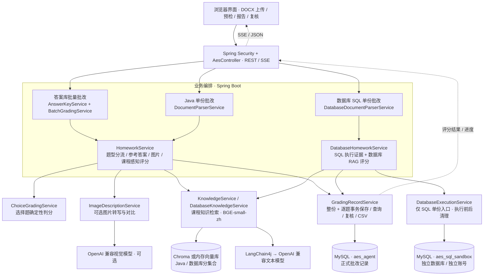
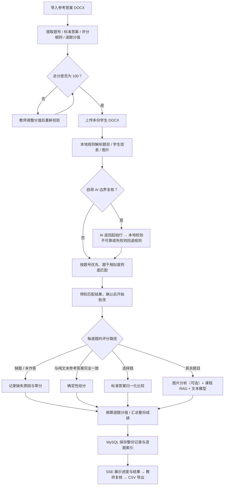

# AES Agent · Java 与数据库作业智能批改系统

> 把 Word 作业转换为可追溯的评分报告：从题目识别、参考答案匹配到 RAG 评分、SQL 执行证据与教师复核。

[源码](https://github.com/CyuYing/aes-agent-java) · [下载 Windows 便携版](https://github.com/CyuYing/aes-agent-java/releases/tag/v1.1.0) · [快速开始](#快速开始) · [架构设计](#架构设计) · [完整使用与部署手册](#完整使用与部署手册)

## 项目介绍

AES Agent 面向 Java 与数据库课程的作业批改场景。教师上传 DOCX 作业和参考答案后，系统提取题目、作答及图片，按题型选择确定性答案对比或大模型评分，并保留评分依据，方便核对与复盘。

项目采用 **Java 17 + Spring Boot + LangChain4j**，提供浏览器界面、REST API 和 SSE 进度反馈。支持答案库批量批改、Java 单份批改、数据库 SQL 单份批改，以及批改历史查询、教师复核和 CSV 导出。

当前发布版本为 **v1.1.0**。Windows 便携包集成运行环境和 MySQL，适合本地体验；Docker Compose 适合后续服务器部署。AI 文本与图片评估仍需配置可访问的模型服务。

## 技术亮点

| 设计 | 实现方式 | 解决的问题 |
| --- | --- | --- |
| 按题型分流 | 选择题标准答案归一化比较；批量模式下完全一致的纯文本参考答案可直接判定；其余题目使用 RAG 与模型评分 | 避免把所有判分都交给模型 |
| 规则优先的题目识别 | DOCX 段落、表格、图片解析；可选 AI 仅返回题目起始行，本地检查范围、数量与置信度，不可靠时回退规则 | 处理题号、代码编号和子问题混杂的文档 |
| 课程知识库隔离 | BGE-small-zh 本地向量化，Java / 数据库使用不同向量集合 | 减少不同课程的评分材料混用 |
| 可核对的评分证据 | 返回参考答案、检索来源、图片分析；SQL 单份模式附执行结果或错误 | 让教师能追查评分依据 |
| SQL 独立沙箱 | 数据库单份批改通过独立账号访问 `aes_sql_sandbox`；限制语句数量、执行时间和返回行数，执行前后清理 | 在隔离数据库中获取真实 SQL 证据 |
| 记录与复核闭环 | MySQL 事务保存整份记录和逐题索引；支持组合检索、审核状态与 CSV 导出 | 便于按学生、课程和题目复查 |

这些是源码已实现的设计；本项目未提供准确率、并发吞吐量等性能基准。

## 功能梳理

| 功能入口 | 输入 | 处理与输出 |
| --- | --- | --- |
| 答案库管理 | 参考答案 DOCX | 提取题目、答案、评分细则与分值；保存及批改前校验总分为 100 |
| 答案库批量批改 | 答案库 + 多份学生 DOCX | 题号优先、题干相似度兜底匹配；按学生汇总得分，SSE 逐题反馈 |
| Java 单份批改 | DOCX + 逐题配置 | 预览题型与作答，调整标准答案、提示词、图片角色，输出逐题报告 |
| 数据库单份批改 | 含建表 / 初始化 SQL / 学生 SQL 的 DOCX | 独立 MySQL 沙箱真实执行，结合执行证据与数据库 RAG 生成评分 |
| 图片辅助批改 | 题图、学生图、参考图 | 可选视觉模型转写与对比，保留图片分析证据 |
| 知识库管理 | PDF、DOC / DOCX、TXT | 递归加载、分块、向量化；分别同步 Java 与数据库评分材料 |
| 历史与复核 | 学生 / 学号 / 班级 / 课程 / 时间等条件 | 整份与逐题查询、教师审核、CSV 导出 |

**能力边界：** Java 代码通过模型静态分析，不执行编译或单元测试。数据库课程的**答案库批量模式**目前不调用 SQL 沙箱；真实 SQL 执行属于**数据库单份模式**。AI 输出需要教师核对。

## 技术选型

| 层次 | 技术 | 用途 |
| --- | --- | --- |
| 应用服务 | Java 17、Spring Boot 3.5.3、Spring Security | HTTP API、SSE、可选教师 Basic 认证 |
| 模型接入 | LangChain4j 0.36.2、OpenAI 兼容模型接口 | 文本评分、可选题目边界复核与视觉分析 |
| RAG | BGE-small-zh 本地 ONNX、Chroma / 内存向量库 | 知识材料向量化与按课程检索 |
| 文档解析 | Apache POI、Apache PDFBox、Apache Tika | 作业结构和图片提取、知识文档读取 |
| 数据存储 | MySQL 8 | 正式批改记录；独立库、独立账号执行 SQL 作业 |
| 前端 | HTML / CSS / JavaScript、Marked WebJar、Fetch | 作业上传、预检、流式进度、Markdown 报告 |
| 交付 | Docker Compose、Windows 便携打包脚本 | 本地运行与服务器迁移 |

## 架构设计

### 系统架构

下面区分三种业务入口，以及它们共享的评分、检索和持久化服务。箭头表示调用或数据流，不表示异步队列。



批量模式中的答案库保存在 `data/answer_keys/`；DOCX 结构解析和可选 AI 边界复核由 `AssignmentDocumentService` 等解析服务完成。正式记录库与 SQL 沙箱必须使用不同账号和权限。

### 答案库批量批改流程



### RAG 数据流

知识文档 → PDFBox / Tika 读取 → 文本分块 → BGE-small-zh 本地向量化 → 对应课程向量集合。

批改时使用题干、学生作答、参考答案及图片描述构建检索查询，将命中的评分材料与来源合并到 Prompt，再调用文本模型生成结构化评分结果。Chroma 可选；关闭或初始化失败时使用内存向量库，内存数据会随进程退出而丢失，可从本地知识文档重建。

## 快速开始

### Windows：下载即可体验

1. 打开 [v1.1.0 Release](https://github.com/CyuYing/aes-agent-java/releases/tag/v1.1.0)，下载 `AES-Agent-Windows.zip`，解压到可写目录。
2. 运行 `doctor.cmd` 检查环境，再运行 `start.cmd`。按照启动提示配置模型 API Key。
3. 浏览器访问 `http://127.0.0.1:8080`。便携版 MySQL 默认使用本机 `3307` 端口。
4. 使用包内示例或仓库中的 `专业课程作业批改案例/` 体验预检与批改。结束后运行 `stop.cmd`。

不配置模型 Key 时仍可使用本地文档解析、确定性答案判定等功能；模型评分与图片分析需配置对应服务。便携版无需在目标电脑单独安装 JDK、Maven、MySQL、Python、Node.js 或 Chroma。

### Docker：准备服务器部署

安装 Docker 与 Compose 后：

```bash
git clone https://github.com/CyuYing/aes-agent-java.git
cd aes-agent-java
# Linux / macOS
bash deploy.sh
```

Windows 使用 `deploy.cmd`。脚本会准备 `.env`、生成缺失密码并启动应用、MySQL、Chroma。配置模型时在本机 `.env` 中设置 `GRADING_API_KEY`、`GRADING_BASE_URL`、`GRADING_MODEL`；图片评估另设 `VISION_ENABLED` 与 `VISION_*`。

默认监听 `127.0.0.1:8080`，Docker 版默认启用教师认证。服务器访问通过 HTTPS 反向代理提供，保留教师认证；MySQL 和 Chroma 不需要开放公网端口。

### 源码开发与测试

需要 JDK 17+、Maven 3.8+ 和 MySQL 8。先复制配置模板，配置正式记录库、独立 SQL 沙箱的账号和模型环境变量：

```powershell
Copy-Item src/main/resources/application-example.properties src/main/resources/application.properties
mvn test
mvn spring-boot:run
```

健康检查：`GET http://127.0.0.1:8080/api/health`。外部 MySQL 集成测试需要单独的测试环境变量；未配置时相关测试会跳过。完整配置、打包和排错见下方手册。

## 代码导航

```text
aes-agent-java/
├── src/main/java/com/aes/
│   ├── config/                     # 模型、向量库与教师认证
│   ├── controller/                 # REST / SSE 与异常处理
│   ├── model/Dto.java              # 请求、题目、评分与预检结构
│   └── service/
│       ├── AssignmentDocumentService.java   # 学生信息与作业结构
│       ├── AiQuestionRecognitionService.java # 可选 AI 边界复核
│       ├── AnswerKeyService.java            # 答案库与分值校验
│       ├── BatchGradingService.java         # 批量匹配与评分编排
│       ├── HomeworkService.java             # Java / 混合题型评分
│       ├── DatabaseHomeworkService.java     # SQL 单份评分
│       ├── DatabaseExecutionService.java    # MySQL 沙箱执行
│       ├── ChoiceGradingService.java        # 确定性答案比较
│       ├── ImageDescriptionService.java     # 视觉证据
│       ├── KnowledgeService.java            # Java RAG
│       ├── DatabaseKnowledgeService.java    # 数据库 RAG
│       └── GradingRecordService.java        # 记录、查询、复核、导出
├── src/main/resources/             # 配置示例与浏览器前端
├── src/test/                       # 解析、答案库、权限、存储等测试
├── data/                           # 分课程知识库、答案库、旧记录备份
├── 专业课程作业批改案例/           # Java / 数据库参考答案与学生作业
├── packaging/                      # Windows 便携包构建与启动脚本
├── deploy/                         # 容器入口与 MySQL 初始化
└── compose.yaml                    # 应用 / MySQL / Chroma 编排
```

## 使用边界与数据备份

- AI 评分用于辅助教学，最终结果由教师复核；模型失败或解析失败应检查逐题评估状态。
- 正式历史保存在 MySQL。旧 JSON 记录可在启动时迁移，原文件保留作备份。
- 便携版迁移前先运行 `stop.cmd`，完整保留 `data/mysql/data/` 和 `data/mysql/credentials.properties`；Docker 部署需备份 MySQL 数据卷及挂载的 `data/`。
- API Key 使用环境变量或未提交的本机配置；不要放入仓库、截图或便携分发包。

## 完整使用与部署手册

<details>
<summary><strong>展开：操作步骤、模型配置、打包部署、API、知识库与常见问题</strong></summary>

## 三、使用说明

### 3.1 系统首页

启动应用后，浏览器访问 `http://localhost:8080`，进入系统首页。

页面分为左右两栏：
- **左侧边栏**：知识库管理、评估类型选择、检索上下文显示开关
- **右侧主区域**：两个功能 Tab ——「答案库批量批改」和「单份作业批改」。单份入口会自动识别 Java/数据库课程，也允许教师手动切换

---

### 3.2 知识库管理

知识库分为 Java 知识库和数据库知识库，分别用于存放对应课程的评分标准、原理说明、参考范例和作业样例。批改时会自动从对应知识库中检索相关标准进行对照评分，避免 Java 与数据库评分依据混用。

#### 步骤 1：放入评分标准文档

将 Java 作业评分标准文档（支持 `.pdf`、`.docx`、`.txt`）复制到项目目录的 `data/java_knowledge_base/` 文件夹下；将数据库作业评分标准文档复制到 `data/database_knowledge_base/` 文件夹下。

建议按以下格式命名文件名，系统会自动提取元数据：

```
Java编码规范_代码风格_Java17.docx
Java作业评分标准_构造方法重载_Java17.txt
数据库原理评分标准_SQL作业.txt
数据库参考范例_学生选课查询_SQL.txt
```

#### 步骤 2：同步知识库

点击左侧边栏的 **「同步 Java 知识库」** 或 **「同步数据库知识库」** 按钮，系统会自动加载文档、分块、向量化并建立索引。

同步完成后，左侧会显示已索引的片段数和文件列表。

> **提示**：如需更新评分标准，直接替换或新增对应知识库目录中的文件，然后重新点击同步即可。

---

### 3.3 答案库批量批改（推荐）

数据库课程的批量批改使用参考答案匹配、图片分析与学科 RAG 评分；当前不接入 SQL 沙箱。需要真实 SQL 执行证据时，请使用数据库单份批改入口。

项目已内置 `专业课程作业批改案例/`：Java 与数据库各包含一份参考答案和三份学生作业。

1. 打开「答案库批量批改」，选择已有答案库；也可上传文件名包含“参考答案”的 DOCX 自动建库。
2. 核对系统从“本题 X 分”等文字识别出的逐题分值。未写明的题会分配剩余分值并标记为推断；教师可编辑，但合计必须为 100。
3. 一次选择多份学生 DOCX，或直接选择同一课程案例文件夹。系统自动排除参考答案并提取姓名、学号、班级。
4. 题号排版不统一或题内编号较多时，可勾选“AI 复核题目边界”；先执行预检，确认每份作业的题号匹配与识别状态，再开始批改。
5. 页面实时展示逐题进度，完成后按成绩排名，可展开核对评分证据并导出 CSV。

参考答案会同时保存到 `data/answer_keys/` 和课程知识库的 `reference_answers/` 子目录；知识库会递归索引这些文档。

---

### 3.4 Java 作业文档批改

适用于逐份批改学生提交的 Word 作业文档，可混合包含编程题、选择题、主观题和图片作答题。

#### 操作步骤

1. 切换到 **「单份作业批改」** Tab，课程识别保持“自动识别”或手动选择“Java 程序设计”
2. 点击或拖拽上传学生的 `.docx` 作业文档

3. 系统先拆解并展示每一道题；逐题确认题型、解析出的学生答案以及每张图片的角色
4. 选择题填写标准答案；其他题可填写文字参考答案
5. （可选）为每题填写定制提示词、上传一张或多张参考答案图片
6. 点击 **「按逐题配置开始批改」** 按钮

选择题采用本地确定性答案对比；编程题、主观题和图片作答题使用各题的提示词、RAG 上下文及图片处理证据进行评分。

#### 每一道题是怎样识别的

1. Apache POI 按 Word 原始顺序读取段落、表格和内嵌图片，并用占位符把图片保留在原位置。
2. 本地规则优先识别 `【第2题】`、`第1题`、`题目三` 等明确题号；对 `1.`、`（2）`、`一、` 等简写题号，选择最长连续编号序列，并排除代码、选择项和小问编号。
3. 系统按边界切分题干与学生作答，再识别编程题、选择题、主观题、图片题以及图片角色。即使某道明确编号的题没有作答，也会保留为空题，避免后续题号错位。
4. 批量模式先按题号与答案库精确匹配，再以题干相似度兜底；答案库题数同时作为边界校验依据。

“AI 复核题目边界”默认关闭。启用后，模型只能返回原文中的顶层题目起始行号，切分仍由本地代码完成；返回内容必须通过行号范围、严格递增、题数和置信度校验。学生文档被当作不可信数据，文档内的提示词不会被执行。AI 超时、密钥不可用或结果不可靠时，页面会显示回退状态并继续使用本地规则。该选项会增加一次文本模型调用，适合题号不规范、复杂表格或题内编号较多的作业。

图片会根据前面的“题图 / 学生答案 / 参考答案”等标记归入对应角色，教师仍可在预览中核对和修正。

---

### 3.5 数据库作业文档批改

适用于逐份批改数据库 SQL 作业文档。文档建议包含题目要求、初始化 SQL 和学生 SQL。

#### 操作步骤

1. 切换到 **「单份作业批改」** Tab，课程识别保持“自动识别”或手动选择“数据库原理”
2. 上传 `.docx` 数据库作业文档；自动识别成功后，页面会在同一入口切换为 SQL 执行核验模式
3. 点击 **「开始批改数据库作业」** 按钮

系统会自动解析 SQL、使用独立 MySQL 8 沙箱真实执行，并把执行结果作为评分证据传给 AI。沙箱账号无权读取正式批改记录库，且每道作业执行前后都会清理表和视图。

---

### 3.6 查看批改结果

批改完成后，页面会展示：

#### 总分汇总

顶部显示作业总分卡片，包含文件名称和总分：

上传并开始批改后，总分汇总、逐题详情、SQL 执行证据（数据库单份模式）和 RAG 来源会在同一工作台下方展开。

#### 逐题详情

每道题以卡片形式展示，默认折叠。点击卡片可展开查看：

- **题号与标题**：如 `【第2题】`
- **各维度得分**：是否符合题意、代码规范、逻辑正确性、性能与效率、可维护性
- **详细评语**：Markdown 格式，包含总体评价、逐条问题清单、改进建议、代码片段对比

### 3.7 批改记录与教师复核

每次 Java、数据库或答案库批量批改成功后，整份结果与逐题明细会在同一事务中写入 MySQL `aes_agent` 数据库。旧版 `data/grading_records/*.json` 会在首次启动时幂等迁移，原文件保留为备份。左侧“批改记录”支持：

- 查看文件、学生姓名、学号、班级、总分、时间和逐题评语；
- 打开“详细查询数据库”，按课程、姓名、学号、班级、文件/内容关键词、日期、审核状态和整份分数区间组合筛选；
- 切换到“逐题批改明细”，再按题号或题目/答案/评语关键词定位，例如直接查询“张三的第 3 题”；
- 教师确认结果，或填写原因并标记为“需调整”；
- 一键导出带 UTF-8 BOM 的 CSV，可直接用中文版 Excel 打开；
- 便携包随 U 盘移动时，先停止服务再复制整个便携文件夹，MySQL 数据、凭据、答案库和历史记录会一并携带。

---

## 四、部署与软件分发

### 4.1 交付方式

| 方式 | 目标电脑需要安装 | 适用场景 |
|---|---|---|
| Windows 便携软件 | 无需 JDK、Maven、MySQL、Python、Node.js 或 Chroma | U 盘、教室电脑、单机演示 |
| Docker 一键部署 | Docker Desktop，或 Linux Docker + Compose | 服务器、长期运行、多人共用 |
| 源码运行 | JDK 17+、Maven、MySQL 8 | 开发和二次修改 |

Qwen、DeepSeek 等批改模型通过在线 API 调用。没有模型密钥时，程序仍可使用文档解析、答案库、题号匹配、选择题精确批改、知识库索引、MySQL 查询和 SQL 沙箱等本地功能。

### 4.2 制作 Windows 便携软件

制作电脑需要 JDK 17+、Maven 和 MySQL Server 8。双击：

```text
build-portable.cmd
```

默认生成：

```text
target/aes-agent-portable-windows/
target/aes-agent-portable-windows.zip
target/aes-agent-portable-windows.zip.sha256
```

也可以指定英文输出名：

```powershell
powershell.exe -NoProfile -ExecutionPolicy Bypass `
  -File .\packaging\build-portable.ps1 `
  -OutputName AES-Agent-Windows
```

脚本会运行测试、构建 Spring Boot JAR、用 `jlink` 生成内置 Java 运行时，并复制 MySQL 8、前端依赖、本地嵌入模型、初始知识库、答案库和完整演示样例。ZIP 旁的 `.sha256` 文件用于校验传输完整性。

### 4.3 在目标电脑或 U 盘运行

1. 完整解压 ZIP，不要直接在压缩包内运行；
2. 可先双击 `doctor.cmd` 检查运行时、目录写权限和端口；
3. 双击 `start.cmd`，按提示输入模型 API Key，也可直接回车只使用本地功能；
4. 百炼新版 `sk-ws-` Key 会自动配置 `qwen3.7-plus` 的文字和图片批改；密钥只传给当前进程，不写入包内文件；
5. 首次运行会初始化包内 MySQL，生成随机数据库凭据，并创建互相隔离的正式记录库与 SQL 作业沙箱；
6. 健康检查通过后访问 `http://127.0.0.1:8080/`；
7. 移动文件夹、复制到 U 盘或关机前，双击 `stop.cmd` 安全停止应用与 MySQL。

便携软件目录结构：

```text
AES-Agent-Windows/
├─ start.cmd                         双击启动
├─ stop.cmd                          安全停止应用和 MySQL
├─ doctor.cmd                        自检运行环境和端口
├─ README.md                         本说明
├─ VERSION.txt                       版本与构建信息
├─ app/aes-agent.jar                 后端、前端与 Java 依赖
├─ config/application.properties    便携版固定配置
├─ runtime/                          内置 Java 运行时
├─ mysql/                            内置 MySQL 8 Server
├─ scripts/                          启动、停止和自检脚本
├─ samples/                          Java、数据库及多模态演示作业
├─ data/
│  ├─ java_knowledge_base/           Java 评分资料
│  ├─ database_knowledge_base/       数据库评分资料
│  ├─ answer_keys/                   结构化答案库
│  ├─ grading_records/               旧 JSON 迁移/备份目录
│  └─ mysql/                         首次运行后生成的数据库状态
├─ logs/                             应用与 MySQL 日志
└─ run/                              进程号等临时状态
```

`start.cmd` 先启动包内 `mysqld.exe`，首次运行时立即设置随机强密码并创建最低权限账号；随后启动 Java 应用并轮询 `/api/health`。进程号写入 `run/`，因此 `stop.cmd` 能精确关闭两个进程。MySQL 默认只监听 `127.0.0.1:3307`。

U 盘或换电脑时必须复制整个文件夹。批改历史在 `data/mysql/data/`，随机凭据在 `data/mysql/credentials.properties`，二者必须一起保留。建议使用可写的 NTFS U 盘、英文目录名，并放在盘符根目录，例如 `E:\AES-Agent-Windows`。端口冲突时可设置 `PORT` 或 `MYSQL_PORT`。

### 4.4 完整功能演示

建议按以下顺序演示：

1. 运行 `doctor.cmd`，再运行 `start.cmd`；需要 AI 和多模态能力时输入可用模型密钥；
2. 进入“答案库批量批改”，选择 Java 或数据库答案库，核对逐题分值与总分 `100/100`；
3. 选择 `samples/专业课程作业批改案例/Java程序设计` 或 `数据库原理` 整个文件夹；系统自动排除参考答案、识别三名学生并完成 `4/4` 题目匹配；
4. 开始批量批改，查看 SSE 实时进度、排名、逐题评分路径、RAG 依据和 CSV 导出；
5. 上传 `samples/Java完整功能演示作业.docx`，演示选择题精确判定、代码评分、主观题和 Word 内嵌图片；第 4 题可上传 `samples/第4题参考答案图.png` 做多模态核验；
6. 上传 `samples/数据库完整功能演示作业.docx`，演示 JOIN、聚合查询、结果表格和危险 SQL 拦截；
7. 打开“详细查询数据库”，按姓名、学号、班级、课程、日期、成绩、审核状态组合查询，再切换到逐题模式定位某学生某一道题；
8. 演示教师确认、标记调整和 CSV 导出，最后运行 `stop.cmd`。

演示覆盖：答案自动建库、分值识别与人工补齐、严格 100 分、Java/数据库批量批改、知识库同步、DOCX 多题拆分、确定性选择题、多模态图片、SQL 真实执行与安全拦截、MySQL 持久化、题目级查询和教师复核。

### 4.5 Docker 一键部署

Windows 安装并启动 Docker Desktop 后双击 `deploy.cmd`；Linux/macOS 执行：

```bash
chmod +x deploy.sh stop.sh
./deploy.sh
```

停止服务使用 `stop.cmd` 或 `./stop.sh`。首次部署会从 `.env.example` 生成本机 `.env`，自动配置应用、MySQL、Chroma、健康检查和持久化卷。`.env` 不得提交或放入分发包。

### 4.6 源码环境准备

#### JDK 17+

```bash
# 验证安装
java -version
# 应显示 17 或更高版本，例如：openjdk version "17.0.8"
```

如未安装，推荐下载 [Eclipse Temurin](https://adoptium.net/) 或 [Oracle JDK](https://www.oracle.com/java/technologies/downloads/)。

#### Maven 3.8+

```bash
# 验证安装
mvn -v
# 应显示 Apache Maven 3.8.x 及以上
```

如未安装：
- **Windows**：下载 [Maven 二进制包](https://maven.apache.org/download.cgi)，解压后配置 `MAVEN_HOME` 和 `PATH`
- **Linux/macOS**：`sudo apt install maven` 或 `brew install maven`

#### （可选）Python 3.10+ 与 Chroma

Chroma 向量库可提升检索性能和持久化能力。如不需要，系统会自动回退到内存向量库。

```bash
# 安装 Chroma
pip install chromadb

# 验证安装
chroma --version
```

---

### 4.7 获取代码

```bash
# 克隆仓库（或下载源码压缩包解压）
git clone https://github.com/CyuYing/aes-agent-java.git aes-agent-java
cd aes-agent-java
```

---

### 4.8 配置修改

先复制配置模板，再编辑本机配置（不要提交真实密钥）：

```powershell
Copy-Item src/main/resources/application-example.properties src/main/resources/application.properties
```

编辑 `src/main/resources/application.properties`：

```properties
# ==========================================
# 推荐：统一的文字/图片批改模型（百炼示例）
# ==========================================
grading.api.key=${GRADING_API_KEY:}
grading.base.url=${GRADING_BASE_URL:https://dashscope.aliyuncs.com/compatible-mode/v1}
grading.model.name=${GRADING_MODEL:qwen3.7-plus}

# ==========================================
# 可选：OpenAI 兼容的多模态视觉模型
# 默认关闭；启用后执行图片转写和参考图/学生图匹配
# ==========================================
vision.enabled=${VISION_ENABLED:false}
vision.api.key=${VISION_API_KEY:disabled}
vision.base.url=${VISION_BASE_URL:https://dashscope.aliyuncs.com/compatible-mode/v1}
vision.model.name=${VISION_MODEL:qwen3.7-plus}

# ==========================================
# 可选：Chroma 向量库
# ==========================================
chroma.base.url=http://localhost:8000
chroma.java.collection.name=aes-java-knowledge
chroma.database.collection.name=aes-database-knowledge

# ==========================================
# 可选：知识库路径
# ==========================================
aes.java.knowledge-base.path=data/java_knowledge_base
aes.database.knowledge-base.path=data/database_knowledge_base
aes.answer-keys.path=${AES_ANSWER_KEYS_PATH:data/answer_keys}
aes.grading-records.path=${AES_GRADING_RECORDS_PATH:data/grading_records}

# MySQL 正式记录库（必填；不提供其他本地数据库回退）
aes.grading-database.url=${AES_GRADING_DATABASE_URL:jdbc:mysql://127.0.0.1:3307/aes_agent?useUnicode=true&characterEncoding=UTF-8&serverTimezone=Asia/Shanghai&useSSL=false&allowPublicKeyRetrieval=true}
aes.grading-database.username=${AES_GRADING_DATABASE_USERNAME:aes_agent}
aes.grading-database.password=${AES_GRADING_DATABASE_PASSWORD:}

# MySQL SQL 作业沙箱，必须使用与正式库不同且仅获沙箱库权限的账号
aes.sql-sandbox.url=${AES_SQL_SANDBOX_URL:jdbc:mysql://127.0.0.1:3307/aes_sql_sandbox?useUnicode=true&characterEncoding=UTF-8&serverTimezone=Asia/Shanghai&useSSL=false&allowPublicKeyRetrieval=true}
aes.sql-sandbox.username=${AES_SQL_SANDBOX_USERNAME:aes_sandbox}
aes.sql-sandbox.password=${AES_SQL_SANDBOX_PASSWORD:}

# 共享/服务器部署时开启；便携单机版默认关闭且仅监听 127.0.0.1
aes.security.enabled=${AES_SECURITY_ENABLED:false}
aes.security.username=${AES_SECURITY_USERNAME:teacher}
aes.security.password=${AES_SECURITY_PASSWORD:}

# ==========================================
# 可选：服务端口
# ==========================================
server.port=8080

# 上传多个参考答案图片时提高整次请求上限
spring.servlet.multipart.max-file-size=10MB
spring.servlet.multipart.max-request-size=200MB
```

`VISION_BASE_URL` 可指向任意实现 OpenAI Chat Completions 图片输入格式的服务。视觉功能关闭或调用失败时，系统会在单题结果中明确显示失败原因，不会虚构图片内容。

直接从源码运行时必须先准备 MySQL 8，并创建 `aes_agent`、`aes_sql_sandbox` 两个数据库和权限隔离的账号。普通 Windows 使用者无需手工配置：便携包会自动初始化内置 MySQL；Docker 部署脚本也会自动创建数据库、账号和随机密码。

---

### 4.9 构建打包

```bash
# 清理并编译
mvn clean compile

# 打包为可执行 JAR（生产部署使用）
mvn clean package -DskipTests
```

打包成功后，会在 `target/` 目录下生成：
```
target/
├── aes-agent-1.1.0.jar          # 可执行 JAR
└── ...
```

---

### 4.10 启动应用

#### 开发模式（热重载，适合调试）

```bash
mvn spring-boot:run
```

#### 生产模式（使用打包后的 JAR）

```bash
# 设置环境变量后启动（Linux/macOS）
export GRADING_API_KEY=your-model-api-key
java -jar target/aes-agent-1.1.0.jar

# Windows PowerShell
$env:GRADING_API_KEY="your-model-api-key"
java -jar target/aes-agent-1.1.0.jar

# Windows CMD
set GRADING_API_KEY=your-model-api-key
java -jar target/aes-agent-1.1.0.jar
```

#### 验证启动

```bash
# 检查服务是否运行
curl http://localhost:8080/api/health
```

健康检查应返回：
```json
{"status":"UP","service":"aes-agent"}
```

**首次启动注意：** BGE-small-zh 模型已包含在应用依赖中，不会在目标电脑再次下载；首次建立知识库索引可能需要几十秒。看到 `Tomcat started on port 8080` 即表示启动成功。

访问前端：`http://localhost:8080`

---

### 4.11 （可选）启动 Chroma 向量库

在另一个终端中执行：

```bash
# 进入项目目录
chroma run --path ./chroma-data
```

Chroma 运行在 `http://localhost:8000`。应用启动时会自动尝试连接，成功日志示例：
```
Chroma 向量库连接成功, collection: aes-java-knowledge
```

若连接失败，会自动降级为内存向量库，不影响核心功能：
```
Chroma 连接失败, 回退到 InMemoryEmbeddingStore
```

---

### 4.12 初始化知识库

1. **准备评分标准文档**
   
   Java 作业评分标准、参考范例放入 `data/java_knowledge_base/`；数据库原理与 SQL 作业评分标准、参考范例放入 `data/database_knowledge_base/`。两套知识库路径和向量集合相互独立，避免 Java 与数据库检索上下文混用。支持格式：`.pdf`、`.docx`、`.txt`。
   
   建议命名格式（系统自动提取元数据）：
   ```
   Java原理评分标准_作业批改_Java17.txt
   数据库原理评分标准_SQL作业.txt
   ```

2. **同步知识库**

   前端左侧可分别点击 **「同步 Java 知识库」** 与 **「同步数据库知识库」**。
   
   也可以调用 API：
   ```bash
   curl -X POST http://localhost:8080/api/knowledge/sync
   curl -X POST http://localhost:8080/api/database/knowledge/sync
   ```

3. **验证知识库**

   ```bash
   curl http://localhost:8080/api/knowledge/stats
   curl http://localhost:8080/api/database/knowledge/stats
   ```
   
   正常应返回非零的 `chunkCount` 和 `fileCount`：
   ```json
   {"chunkCount":42,"fileCount":3,"files":["..."],"metadata":[...]}
   ```

---

### 4.13 功能验证

#### Java 作业文档批改测试

切换到「单份作业批改」Tab，保持自动识别或选择“Java 程序设计”，上传 `.docx` 作业文档，确认拆分出的每道题后开始批改。

或调用 API：
```bash
curl -X POST http://localhost:8080/api/homework/grade \
  -F "file=@作业样本.docx" \
  -F "category=general" \
  -F 'configs=[{"index":1,"questionType":"choice","correctAnswer":"B","customPrompt":"","studentAnswer":"B"}]'
```

#### 数据库作业文档批改测试

切换到「单份作业批改」Tab，保持自动识别或选择“数据库原理”，上传包含题目、初始化 SQL 和学生 SQL 的 `.docx` 作业文档，点击「开始批改数据库作业」。系统会在隔离 MySQL 沙箱中执行 SQL，每题开始与结束时重置沙箱，并在统一结果区展示执行证据。

或调用 API：
```bash
curl -X POST http://localhost:8080/api/database/homework/grade \
  -F "file=@数据库作业样本.docx" \
  -F "category=database"
```

---

## 五、API 接口

| 方法 | 路径 | 说明 |
|------|------|------|
| `GET` | `/` | 前端页面 |
| `GET` | `/api/health` | 服务健康检查 |
| `GET` | `/api/knowledge/stats` | 知识库状态 |
| `POST` | `/api/knowledge/sync` | 重建知识库索引 |
| `GET` | `/api/answer-keys` | 查询结构化答案库 |
| `POST` | `/api/answer-keys` | 导入参考答案并自动识别课程、题目与分值 |
| `PATCH` | `/api/answer-keys/{id}/scores` | 教师调整逐题分值（合计必须为 100） |
| `POST` | `/api/batch/preview` | 批量作业身份与题号匹配预检 |
| `POST` | `/api/batch/grade/stream` | 答案库驱动的批量批改 SSE |
| `POST` | `/api/homework/parse` | 解析 DOCX，自动识别 Java/数据库课程并返回逐题预览（含图片角色） |
| `POST` | `/api/homework/grade` | 作业文档同步批改（multipart） |
| `POST` | `/api/homework/grade/stream` | 作业文档流式批改 SSE（逐题推送） |
| `GET` | `/api/database/knowledge/stats` | 数据库知识库状态 |
| `POST` | `/api/database/knowledge/sync` | 重建数据库知识库索引 |
| `POST` | `/api/database/homework/grade` | 数据库作业文档同步批改（multipart） |
| `POST` | `/api/database/homework/grade/stream` | 数据库作业文档流式批改 SSE（逐题推送） |
| `GET` | `/api/grading/records` | 查询批改记录摘要 |
| `GET` | `/api/grading/records/search` | 组合查询整份记录（学生、课程、日期、分数、题号/题目关键词等） |
| `GET` | `/api/grading/questions/search` | 查询逐题明细，可定位某学生某道题 |
| `GET` | `/api/grading/storage` | 查询 MySQL 引擎、数据库名、记录数和题目数 |
| `GET` | `/api/grading/records/{id}` | 查看完整批改记录 |
| `GET` | `/api/grading/records/{id}/questions/{questionIndex}` | 直接读取某条记录中的指定题目 |
| `PATCH` | `/api/grading/records/{id}/review` | 保存教师审核状态与意见 |
| `GET` | `/api/grading/records/export.csv` | 导出全部批改记录 CSV |

上述批量预检/批改、单份解析/批改和数据库批改接口均接受可选 multipart 参数 `aiQuestionRecognition=true`；默认值为 `false`。流式批改会先发送 `recognition` 事件，报告实际采用 `rule`、`ai-confirmed`、`ai-refined` 或 `rule-fallback`。

### 请求示例

```bash
# Java 作业文档批改
curl -X POST http://localhost:8080/api/homework/grade \
  -F "file=@作业.docx" \
  -F "category=algorithm" \
  -F 'configs=[{"index":1,"questionType":"programming","correctAnswer":"","customPrompt":"重点检查异常处理","studentAnswer":""}]'

# 如需给第 1 题附加参考答案图，再增加：
# -F "referenceImages=@第1题参考答案.png" \
# -F "referenceImageQuestionIndexes=1"

# 数据库作业文档批改
curl -X POST http://localhost:8080/api/database/homework/grade \
  -F "file=@数据库作业.docx" \
  -F "category=database"
```

---

## 六、知识库管理

### 文件命名规范

文件名自动提取元数据，建议按以下格式命名：

```
{学科}_{类型}_{主题}.txt
```

示例：`Java原理评分标准_作业批改_Java17.txt`、`数据库参考范例_学生选课查询_SQL.txt`

自动提取的元数据字段：

| 字段 | 说明 | 示例值 |
|------|------|------|
| `type` | 文档类型 | `standard`（评分标准）、`reference`（参考范例） |
| `category` | 技术类别 | `java-basics`、`oop`、`sql-query`、`schema-design`、`transaction`、`security` |
| `java` | Java 版本 | `8`、`11`、`17`、`21` |

---

## 七、常见问题排查

### 启动报错：端口 8080 被占用

```bash
# 查找占用进程
# Windows
netstat -ano | findstr :8080
taskkill /PID <进程号> /F

# Linux/macOS
lsof -i :8080
kill -9 <PID>
```

或在 `application.properties` 中修改端口：`server.port=8081`

### API 调用返回 500 / AI 评分无输出

- 检查 `GRADING_API_KEY`（或兼容旧版的 `DEEPSEEK_API_KEY`）是否已正确配置
- 确认 API Key、模型名称、服务地址、网络与账户余额是否正常
- 查看应用控制台日志中的具体错误信息

### Chroma 连接失败

- 确认 Chroma 是否已启动：`curl http://localhost:8000/api/v1/heartbeat`
- 检查 `application.properties` 中的 `chroma.base.url` 是否正确
- 如不需要 Chroma，可忽略此警告，系统会自动使用内存向量库

### 知识库同步后 chunkCount 仍为 0

- 确认 `data/java_knowledge_base/` 目录下存在文件
- 确认文件格式为 `.pdf`、`.docx` 或 `.txt`
- 查看应用日志是否有加载失败的错误提示

### 作业文档解析失败 / 未识别到题目

- 确认上传的是 `.docx` 格式（`.doc` 旧格式兼容性较差）
- 确认文档中包含题号标记（如 `【第1题】`、`第1题`、`1.` 等）
- 如文档无明确题号，系统会将整个文档视为一道题进行批改
- 对题号不规范或题内编号复杂的文档，勾选“AI 复核题目边界”；若页面显示“已自动使用本地规则”，请检查模型 API 配置或在预检页人工核对

---


</details>

## 学习与文档参考

- [RAG 与 Agent 项目实战教程（Bilibili）](https://www.bilibili.com/video/BV1yjz5BLEoY/)：学习参考，视频内容不是本仓库的实际演示。
- [AI 超级智能体项目介绍（飞书）](https://yuyuanweb.feishu.cn/wiki/D4VSwmWJviWiCekA78ocIZM5nz6)：参考项目介绍、功能梳理、技术选型与分层架构的组织方式。

本仓库的功能与技术描述以现有源码为准。
